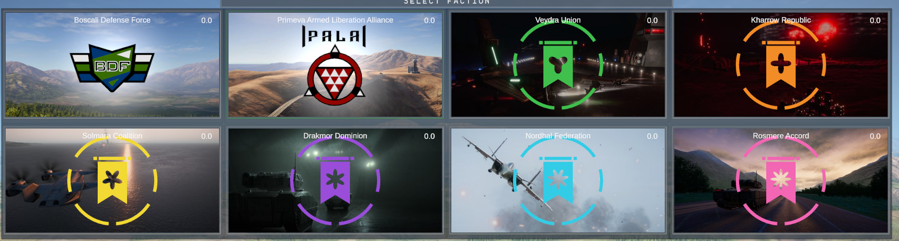

# Ground Control Factions


Up to ten factions in one Nuclear Option match. A BepInEx 5 plugin that works on the base game on
its own, and with Ground Control RTS when both are installed.

Follow on YouTube: **[youtube.com/@needyboxman](https://www.youtube.com/@needyboxman)**



## Requirements

- Nuclear Option
- BepInEx 5

## Installation

1. Download `GroundControlFactions.zip` from the latest release.
2. In Steam, right-click Nuclear Option, then Manage, then Browse local files.
3. If there is no `BepInEx` folder, install BepInEx 5 first.
4. Extract the zip into `Nuclear Option\BepInEx\plugins`, so the DLL ends up at
   `BepInEx\plugins\GroundControlFactions\GroundControlFactions.dll`.

In multiplayer every player should have it: a guest without it can still join, but only sees and
joins Boscali and Primeva, and is told so in chat.

## Use

- **Customize Mission**: the **Factions** slider (2 to 10) sits under Starting Funds. 2 is the stock game.
- **Mission editor**: the **Factions** row at the bottom of Mission Settings. Raising it adds the new
  factions at once, so every airbase's and unit's faction list offers them and you can give each
  faction its base. Lowering it applies the next time the mission is loaded.

## How it plays

- The added factions are Cindral, Kharrow, Solmara, Drakmor, Nordhal, Ironvale, Rosmere and Veydra,
  each with its own colour and emblem. Each has its own funds, income, warheads, supplies and
  restrictions, copied from the mission's first faction, and each can be joined.
- The faction select screen and the TAB scoreboard show every faction.
- A map never gets more factions than it has bases: enabled airbases plus carriers.
- A faction the mission gives no base is handed the free base furthest from everyone else, or if
  none is free, one from whoever holds the most.
- Factions nobody plays are flown by the game's own AI. The AI aircraft limit is shared out between
  the factions, so a big multi-faction match flies about as many AI aircraft as a normal match.
- A faction that holds no base for 30 seconds is out, and the last faction standing wins. A mission
  objective that defeats a faction knocks that faction out instead of ending the match.

## With Ground Control RTS

Ground Control's AI commander plays every faction nobody plays, each faction handed a base gets a
vehicle depot and munitions bunker there, and a faction its win rules beat is out too. Its
unit cap is shared out the same way.

## Building from source

Requires the .NET SDK and a Nuclear Option installation with BepInEx.

```bash
dotnet build -c Release -p:GameDir="C:\Program Files (x86)\Steam\steamapps\common\Nuclear Option"
```

A Release build also installs the mod into that game folder, so close the game first.

## Contributing and license

Pull requests are welcome, but read **[CONTRIBUTING.md](CONTRIBUTING.md)** first. Changes are listed
in **[CHANGELOG.md](CHANGELOG.md)**.

The code is source-available and free for non-commercial use. See **[LICENSE](LICENSE)**.
